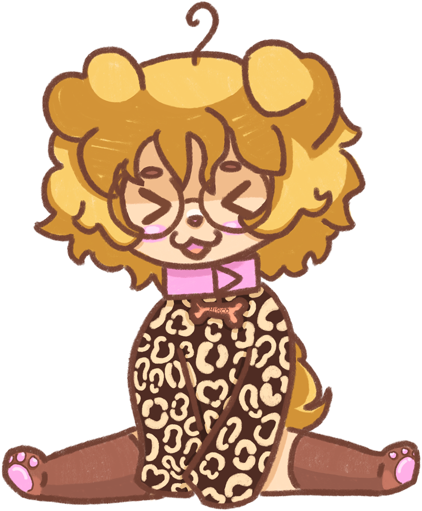

# co-authored-by

this repository documents my solution to properly attributing popular models used by agents when committing and pushing to GitHub repositories.

<sup><sub><a target="_blank" rel="noopener noreferrer" href="https://support.mircowuffwuff.com"></a> click me</sub></sup>

## the problem

i love **transparency** and the idea of clearly flagging commits that include code written by an AI agent. i have fallen in love with the way Claude does it: credit a "claude" GitHub account, which features a proper Claude logo profile picture. but what about other models? other agents?

## the solution

i have created a set of GitHub accounts with `<short model name>wuff` for usernames, `<short model name>@mircowuffwuff.com` for emails, their proper model name's spelling as a display name, and a somewhat official logo for a profile picture.

### usage

paste the following somewhere into your `AGENTS.md` to make your agent obey from now on:

~~~markdown
## commit authors

for transparency and tool usage attribution reasons: **any commit** that **includes code written by any AI agent** properly displays as co-authored by said agent on GitHub. this is achieved by appending a functional `co-authored-by: ...` trailer:

```
{commit message}

co-authored-by: {agent}/{model with version} <{email address}>
```

three concrete examples:

```
fix(host): leave the top word of a guest's stack zero, as the kernel does

co-authored-by: Claude Code/Claude Opus 5.5 <noreply@anthropic.com>
```

```
co-authored-by: Antigravity/Gemini 3.8 Flash <gemini@mircowuffwuff.com>
```

```
co-authored-by: Codex/GPT 6.1 Sol <gpt@mircowuffwuff.com>
```

and one example for a commit including code written by *multiple* AI agents, e.g. a Claude Code session who commissioned a Codex subagent through t3 code:

```
co-authored-by: Claude Code/Claude Opus 5.5 <noreply@anthropic.com>
co-authored-by: Codex/GPT 6.1 Sol <gpt@mircowuffwuff.com>
```

**the trailer block stays last**, in a rewritten message too: GitHub credits a co-author only there.

what follows is a table of exact emails to pass for popular models. proper LLM model attribution in GitHub's UI can only be guaranteed this way. if the model that powers an agent is listed, the listed email is to be used, no matter what:

| model | email address |
| --- | --- |
| Claude | noreply@anthropic.com |
| Gemini | gemini@mircowuffwuff.com |
| GPT | gpt@mircowuffwuff.com |
| Qwen | qwen@mircowuffwuff.com |
| DeepSeek | deepseek@mircowuffwuff.com |
| Grok | grok@mircowuffwuff.com |
| Muse | muse@mircowuffwuff.com |
| MiMo | mimo@mircowuffwuff.com |
| GLM | glm@mircowuffwuff.com |
| Kimi | kimi@mircowuffwuff.com |
~~~

this text will be updated over time and the list of supported models will increase, as the agentic engineering landscape evolves.

### tested with

by me <a target="_blank" rel="noopener noreferrer" href="https://support.mircowuffwuff.com"></a>, as of October 30th, 2026:

| agent | app | obeys |
| --- | --- | --- |
| Claude Code | Claude | ✓ |
| Codex | ChatGPT | ✓ |
| Antigravity | Antigravity | ✓ |

this depends on whether an agent knows what model powers them. i think not all of them do, but these three do for sure.

## the elephant in the room

Claude simply credits e.g. `Claude Opus 5.5 <noreply@anthropic.com>`. this does not form a clear convention, since their agent `Claude Code` and their model `Claude Opus 5.5` are both named Claude.

well, i have decided to primarily credit models, not agents. i think Claude's precedent leans into this direction and it feels more natural to me to credit `Gemini` instead of `Antigravity`.

i am not super sure about this though, which is why i might expand this project by an "agents" alternative at some point.

## propose an improvement

whether it be a **new model** or a **more appropriate display name** for one, you may feel free to open an **issue**! or, if you want to offer a **better profile picture** for a model's GitHub account, you may open a **PR**! i track the profile pictures i use in this repository.

<p align="center">
    <a target="_blank" rel="noopener noreferrer" href="https://support.mircowuffwuff.com">
        
    </a>
</p>
